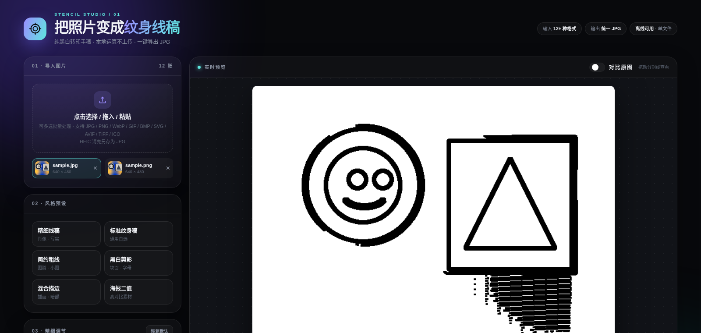
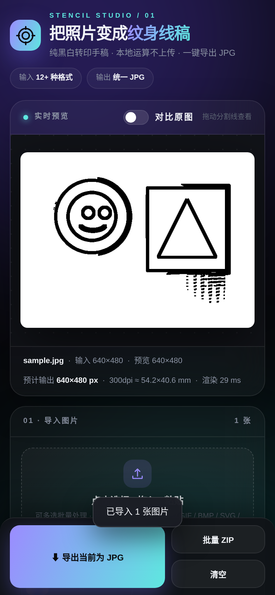

# Stencil Studio · 纹身线稿生成器

把照片、插画、扫描手稿一键转换成适合**转印纸 / 热敏打印机**的纯黑白线描图，输出统一为 JPG。

纯前端、完全离线、图片不上传；既是一个可直接双击打开的单文件网页，也有对应的 Android APK。



<p align="center"></p>

---

## 特性

- **格式通吃**：JPG / PNG / WebP / GIF / BMP / SVG / AVIF / TIFF / ICO。TIFF（含 LZW、Deflate、灰度、多页）通过内嵌解码器支持；HEIC / HEIF 需先另存为 JPG。
- **统一输出**：单张导出 `xxx_stencil.jpg`；多张可打包成 ZIP，包内同样是 JPG。可写入 96 / 150 / 300 / 600 DPI，打印时即为对应物理尺寸。
- **细节自由可控**：一个「细节程度」滑块联动平滑半径、边缘阈值、局部窗口与去噪强度；另有 6 个风格预设。
- **完整画面调节**：亮度、对比度、伽马、线条灵敏度、平滑降噪、杂点清除、线条加粗、反色、输出尺寸、白边留白、JPG 质量。
- **4 种描线算法**：Sobel 轮廓线稿、自适应阈值块面、混合描边、Otsu 全局二值。
- **实时预览**：原图 / 线稿拖动分割对比，滚动调参时预览保持可见；移动端为单栏 + 底部固定操作栏。
- **纯黑白无灰阶**：结果只有 0 与 255，转印、热敏打印不会糊成灰块。
- **零依赖、零联网**：Web 版是单个 `index.html`，Android 版把同一份 HTML 打包进 assets。

## 快速开始

### Web 版

双击根目录的 `index.html` 即可（推荐 Chrome / Edge / Safari / Firefox）。也可以把 `docs/sample.jpg` 拖进去试手。

### Android 版

从 [Releases](../../releases/latest) 下载 `StencilStudio.apk`，在手机上允许「安装未知来源应用」后安装。

- 最低 Android 7.0（API 24），目标 API 34。
- 点击「选择图片」调用系统文件选择器，支持多选。
- 导出的 JPG / ZIP 保存到系统「下载」目录。
- 应用为自签名；首次安装时系统会提示来源未知，属正常现象。

## 参数速查

| 参数 | 作用 |
| --- | --- |
| 细节程度 | 核心滑块。越高保留越多细碎纹理，越低只留干净的粗轮廓 |
| 线条灵敏度 | 越高越容易把微弱明暗变化判成线条 |
| 亮度 / 对比度 / 伽马 | 在描线前调整灰度分布，挽救偏暗或偏灰的原图 |
| 平滑降噪 | 先模糊再描线，去掉皮肤颗粒与网纹 |
| 杂点清除 | 删除孤立小黑点、断线 |
| 线条加粗 | 对二值图做形态学膨胀，线更实、转印更耐久 |
| 输出尺寸 / 白边 | 导出分辨率与四周留白 |
| 打印 DPI | 写入 JPG 的 JFIF 密度字段，状态栏同步显示预计毫米尺寸 |

**调参顺序建议**：先选预设 → 调细节程度 → 加对比度 / 平滑 → 微调灵敏度 → 用杂点清除收尾。

## 实现说明

图像处理全部在 Canvas 上用 JS 完成：

1. 灰度化 → 亮度 → 对比度 → 伽马（查表加速）
2. 可分离均值滤波（滑动窗口，O(n)）做平滑与局部均值
3. Sobel 边缘 / 自适应阈值 / 混合 / Otsu 全局二值，生成二值 mask
4. 邻域统计去孤点 → 可选 3×3 膨胀加粗 → 反色 → 白边
5. `canvas.toBlob('image/jpeg')` 输出，随后改写 JFIF APP0 段的密度字节写入 DPI

Android 端是一个极简 WebView 外壳：

- `onShowFileChooser` 接系统文件选择器，把 `content://` 复制到应用缓存后以 `file://` 交回 WebView，规避部分机型读不到内容 URI 的问题，并保留原文件名。
- JS 通过 `AndroidBridge.chunk / finish` 分块回传 base64（规避 Binder 单次事务大小限制），原生侧拼装后用 `MediaStore.Downloads`（Android 10+）或公共下载目录（Android 9 及以下）落盘。
- Web 版检测到 `window.AndroidBridge` 时自动切换到原生路径，桌面浏览器仍使用 Blob + `<a download>`。

## 自行构建 APK

需要 JDK 17+、Android SDK（build-tools 34 与 platform android-34）、`zip`、`keytool`。

```bash
git clone <你的仓库地址>
cd tattoo-stencil-studio/android
ANDROID_SDK=/path/to/Android/Sdk ./build.sh
# 产出：../StencilStudio.apk
```

构建脚本只用 `aapt2` / `javac` / `d8` / `zipalign` / `apksigner`，不需要 Gradle 或 Android Studio，也不下载任何构建依赖。密钥为本地生成的自签名 debug 密钥，**请勿用于正式发布**。

## 目录结构

```
index.html                     Web 版（单文件，含内嵌解码库）
android/
  AndroidManifest.xml
  src/.../MainActivity.java     WebView 外壳 + 文件选择 + 保存
  res/drawable/ic_launcher.png
  build.sh                      命令行构建脚本
docs/                          预览图与测试素材
```

## 第三方代码

| 库 | 用途 | 许可 |
| --- | --- | --- |
| [UTIF.js](https://github.com/photopea/UTIF.js) | TIFF 解码 | MIT |
| [pako](https://github.com/nodeca/pako) | Deflate 压缩 TIFF 的 inflate | MIT |

两者以源码形式内嵌在 `index.html` 中，保证离线单文件可用。

## 许可

[MIT](LICENSE)
